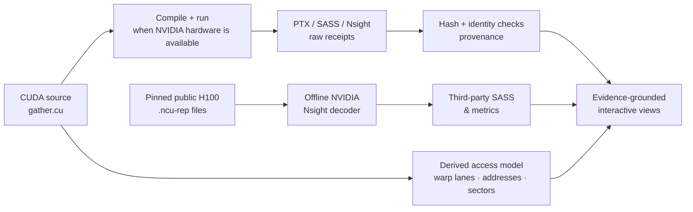

<div align="center">

# GPU Uncooked

### Step inside CUDA. Follow the instructions. Question the numbers.

**An interactive, evidence-driven GPU exploration lab.**  
Walk through a GPU world, inspect CUDA memory behavior, and investigate real Hopper SASS instructions—without confusing a beautiful reconstruction with what the silicon actually did.

[**Explore the Material Lab**](playground/material-lab/index.html) · [**Enter the CUDA Microverse**](playground/microverse/index.html) · [**Explore Silicon City**](playground/city3d/index.html) · [**Inspect the H100 evidence**](docs/PUBLIC_H100_SASS_DIFFERENCE.md)

**Three.js · CUDA C++ · PTX / SASS · Nsight Compute · Python · Node.js**

</div>

---

## This isn't another GPU diagram.

Most GPU visualizations tell you *what* an SM, warp, or cache is.

**GPU Uncooked asks a harder question: what evidence connects the CUDA code you wrote to the work the GPU actually reported doing?**

You can change the memory-access stride of a real CUDA `gather` example and see the **derived** addresses and 32-byte regions. You can inspect the code's execution-accounting ledger. You can also investigate **vendor-decoded, third-party H100 reports** to see how two Hopper kernels differ at the SASS instruction level.

Every view keeps the same boundary: **derived ≠ profiler-reported ≠ independently hardware-attested.**

### One real example: fewer shared-memory stores, more register permutations

Two public Hopper `full_source` Nsight Compute reports contain separate kernel identities and their own SASS execution statistics:

| From the archived reports | RS-WGMMA | Transposed memdesc |
|:--|--:|--:|
| **Kernel duration** | **60.864 μs** | **41.184 μs** |
| Registers / thread | 118 | 80 |
| Static SASS lines | 1,488 | 1,440 |
| **`STS` executed** | **1,229,824** | **181,248** |
| **`PRMT` executed** | **17,152** | **803,584** |
| `QGMMA` executed | 131,072 | 131,072 |

**The puzzle:** The matrix-operation instruction count is unchanged. Shared-memory stores plummet; register permutations surge. The second kernel's *reported* duration is shorter.

What happened in the operand-preparation path? Is this a deliberate trade between shared-memory traffic and register-level reordering? **Explore the SASS inspector, then challenge the hypothesis.**

> **Evidence boundary:** These are vendor-decoded **third-party** reports labeled `THIRD_PARTY_UNVERIFIED`, not a benchmark we independently reran on H100. The values come from the **same pair of full-source reports**; they must not be mixed with separate 61.056/38.816 μs reports. Counts are aggregated **instruction executions, not cycles**. This comparison does not prove which change caused the runtime difference.

[Read the SASS evidence and caveats](docs/PUBLIC_H100_SASS_DIFFERENCE.md) · [See the successful offline decode run](https://github.com/hippoley/GPU-Uncooked/actions/runs/45096310906) · [Inspect the source-side decoder](tools/diff_public_h100_sass.py)

## Choose your way in

| Experience | What you actually do | Evidence level |
|:--|:--|:--|
| **[Real-Material Lab](playground/material-lab/index.html)** | Select a CUDA `gather` stride, inspect lane addresses and sectors, import receipts, investigate `QGMMA`, `STS`, `PRMT` | Derived source model + separately labeled third-party H100 reports |
| **[CUDA Microverse](playground/microverse/index.html)** | Navigate an interactive GPU-inspired environment and explore its layers | Educational spatial reconstruction |
| **[Silicon City 3D](playground/city3d/index.html)** | Explore a self-contained GPU-inspired 3D world | Interactive visualization, **not** physical silicon telemetry |
| **[Guided CUDA chapters](playground/chapters/index.html)** | Work through thread mapping, warp divergence, and memory coalescing | Interactive teaching models |
| **[Original GPU Kitchen](playground/index.html)** | Experiment with how compute and supply bottlenecks interact | Explicitly simplified capacity analogy |

### Run locally

From the repository root:

```bash
git clone https://github.com/hippoley/GPU-Uncooked.git
cd GPU-Uncooked
python3 -m http.server 8000
```

Open the workbench at **http://localhost:8000/playground/material-lab/**.

Other local entry points are `/playground/microverse/`, `/playground/city3d/`, and `/playground/chapters/`. The Python server simply serves files; **no NVIDIA GPU is needed to explore the models or the archived report excerpts**. The source Material Lab uses JavaScript modules with Three.js; for a standalone build, follow the build instructions below.

> The active workbench and its latest evidence features are developed in [PR #2](https://github.com/hippoley/GPU-Uncooked/pull/2), branch `feat/interactive-gpu-kitchen-playground`. If your clone's `main` does not contain them yet, switch to that branch. GitHub Pages deployment is **not a verified public entry point** at this time.

## The evidence chain



**What the labels mean:**

- **`DERIVED`** — determined from source and stated assumptions (such as lane-to-address mapping); **not** a hardware observation.
- **`REPORTED_UNVERIFIED`** — operator-provided profiler output with software-side provenance and integrity checks; **not** independent device attestation.
- **`THIRD_PARTY_UNVERIFIED`** — archived upstream measurements decoded from pinned public reports. The report bytes and parsing may be checked; **the H100 execution was not reproduced here**.
- **`UNKNOWN`** — a requested hardware fact is not established. We show the gap rather than invent a cycle trace.

**What this project does not do:** emulate a transistor-accurate H100, recover per-warp execution timing from aggregate counters, or prove performance causality from opcode totals alone.

## Reproduce the experiment—not just the screenshot

### A. Verify the CUDA gather semantics without a GPU

```bash
node --test tests/material-execution-accounting.test.mjs
node --test tests/material-sass-inspector.test.mjs
```

The source kernel lives in [`playground/material-lab/gather.cu`](playground/material-lab/gather.cu). For the three stride cases, the deterministic source-side model predicts:

| Stride | Distinct 32-byte source regions covered by 32 lanes |
|--:|--:|
| 1 | 4 |
| 4 | 16 |
| 8 | 32 |

This is **address coverage**, not measured HBM traffic. For a controlled actual GPU receipt, follow [the CUDA capture runbook](docs/GATHER_GPU_CAPTURE.md) and [the Nsight three-stride protocol](docs/NCU_THREE_STRIDE_EVIDENCE.md).

### B. Decode the public Hopper evidence without a GPU

The archived Nsight reports are downloaded **from a pinned upstream Git commit** and verified against their Git Blob hashes before decoding. On a machine with compatible NVIDIA Nsight Compute (`ncu`):

```bash
python3 tools/public_h100_reports.py fetch \
  --report rswgmma_uniform4096 \
  --dir /tmp/gpu-public-reports

python3 tools/public_h100_reports.py extract \
  --report rswgmma_uniform4096 \
  --dir /tmp/gpu-public-reports \
  --output /tmp/gpu-public-rswgmma
```

Then repeat for `memdesc_transpose_uniform4096`. To investigate the two **distinct full-source kernels**, use the `*_full_source` report IDs and the [SASS diff tool](tools/diff_public_h100_sass.py).

You can also inspect the [successful vendor-decoded CI run and archived outputs](https://github.com/hippoley/GPU-Uncooked/actions/runs/45096310906), subject to GitHub artifact retention. The complete procedure and fixed report identities are in [PUBLIC_H100_EVIDENCE.md](docs/PUBLIC_H100_EVIDENCE.md).

### C. Build the self-contained Material Lab

The checked-in JavaScript source imports Three.js. The standalone build bundles the browser dependencies into one HTML file:

```bash
npm install --no-save --no-audit --no-fund three@0.170.0 esbuild@0.25.12 playwright@1.56.1
node tools/build-material-lab.mjs
```

Open `dist/material-lab/index.html` in a local browser (or serve `dist/` with the Python HTTP server). The build generates a size report and enforces a **1.4 MB Brotli budget**; the budget is a build constraint, **not** a claim about full silicon fidelity.

## Architecture, not theater

| Layer | Implementation | What it can and cannot establish |
|:--|:--|:--|
| **Spatial exploration** | Three.js browser scenes | Makes concepts navigable; no claim of exact chip floorplan |
| **CUDA semantics** | Gather kernel + address/sector accounting | Reproducible lane-level address model; no measured cache path |
| **Compiler evidence** | PTX/SASS import and static opcode inspection | Inspects archived instruction representations; no invented dynamic timing |
| **Execution evidence** | Nsight receipt capture, hashing, source/SASS CSV parsing | Attributes reported counters; not an independent hardware witness |
| **Interactive investigation** | Hopper opcode inspector + public report comparisons | Connects reported metrics to technical questions; correlation is not causation |

[Execution accounting contract](docs/EXECUTION_ACCOUNTING_CONTRACT.md) · [Evidence protocol](docs/EVIDENCE_PROTOCOL.md) · [1:1 evidence boundaries](docs/INSIDE_CUDA_1TO1_EVIDENCE_CONTRACT.md)

## Build with us

The most useful contribution is **one falsifiable improvement**: a CUDA kernel with a correctness test, an actual profiler receipt, a reproducible mismatch, a SASS-to-source mapping, or a concrete error in the visualization's explanation.

A good issue or PR states the **hypothesis**, includes **source and environment identity**, supplies **raw artifacts or a minimal fixture**, reports **what failed as well as what passed**, and distinguishes **measured facts from inferences**.

Areas worth investigating next:

- Link a real SASS **program counter and full instruction text** to its own per-address `Instructions Executed` count.
- Understand Hopper `QGMMA` operand setup and synchronization **without inventing an execution order**.
- Re-run the pinned source experiments on controlled NVIDIA hardware and measure repeatability.
- Replace unclear metaphorical visuals with **evidence-addressable, clickable machine behavior**.

See [the research charter](docs/RESEARCH_CHARTER.md), [the archived GPU experiments](campaigns/4090-vs-a100.md), and [the CUDA experiment runbooks](docs/GATHER_GPU_CAPTURE.md).

---

<div align="center">

### The GPU is real. The evidence should be, too.

**Don't just watch the kernel. Ask what proves the story.**

[Explore](playground/material-lab/index.html) · [Read the H100 SASS investigation](docs/PUBLIC_H100_SASS_DIFFERENCE.md) · [Contribute](https://github.com/hippoley/GPU-Uncooked/issues)

</div>
